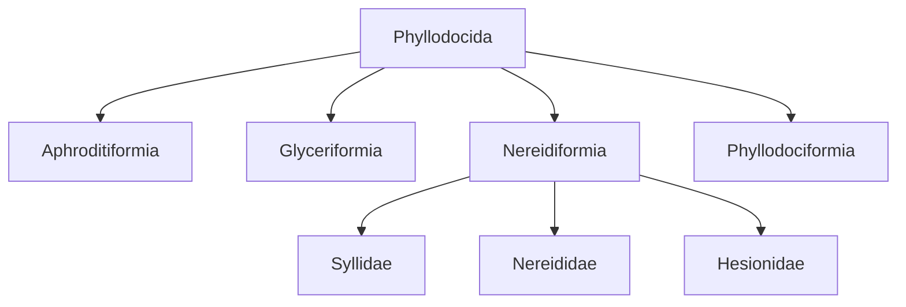

# MiAphro, a collection of 16S and 28S PCR primer candidates for polychaete eDNA metabarcoding

**Fei Xia**

[中文](README.md) | English

## Overview

MiAphro integrates eight nested target units within Phyllodocida: the order itself, four suborders, and three families. It contains 94 current primer pairs (188 oligos) and 8 distinct conditional alternatives (16 oligos). Each unit retains its own reference panel, background panel and selection criteria; this is a collection of computational designs, not one universal assay for all polychaetes.

[Current FASTA](primers.fasta) · [Catalogue](catalog.csv) · [Reference panels](panels.csv) · [Conditional alternatives](conditional/README.en.md) · [Methods](docs/METHODS.en.md)

## Target units

|Target|Rank|16S references|28S references|Results|
|---|---|---:|---:|---|
|Aphroditiformia|suborder|94|68|[Aphroditiformia](panels/Aphroditiformia/README.en.md)|
|Phyllodocida|order|515|302|[Phyllodocida](panels/Phyllodocida/README.en.md)|
|Glyceriformia|suborder|20|12|[Glyceriformia](panels/Glyceriformia/README.en.md)|
|Nereidiformia|suborder|315|133|[Nereidiformia](panels/Nereidiformia/README.en.md)|
|Phyllodociformia|suborder|59|63|[Phyllodociformia](panels/Phyllodociformia/README.en.md)|
|Syllidae|family|180|28|[Syllidae](panels/Syllidae/README.en.md)|
|Nereididae|family|61|52|[Nereididae](panels/Nereididae/README.en.md)|
|Hesionidae|family|53|45|[Hesionidae](panels/Hesionidae/README.en.md)|



The diagram shows included design units, not a complete taxonomic classification. Nested panels contain overlapping species and must not be summed.

## Names and profiles

`MiAphro-{taxon}-{gene}-{length}[2][D]_{F|R}`. S/M/L denote short, medium and long designs. D marks degeneracy in at least one oligo of the pair; each oligo has degeneracy ≤8. The suffix 2 identifies a distinct conditional alternative, not a two-pair mixture. Examples: `MiAphro-Syllidae-16S-S_F`, `MiAphro-Syllidae-16S-SD_R`, and `MiAphro-Syllidae-16S-S2D_R`. Ordinary/D counterparts share all four endpoints within a profile. Different profiles or taxa may use different windows and references.

## Results


The figure shows D coverage within each frozen reference panel. Panel sizes and background composition differ; these are not common-panel comparisons.

- **Aphroditiformia**: The original scale-worm study, base-matching figures, WoRMS genus coverage and preprint are retained.
- **Phyllodocida**: Order-wide coverage remains low; these candidates document the broad-target search.
- **Glyceriformia**: Lacydoniidae is absent from the reference panel; 16S coverage substantially exceeds exact matching.
- **Nereidiformia**: Suborder-wide coverage remains low; three constituent families have separate designs.
- **Phyllodociformia**: The current references represent Phyllodocidae only.
- **Syllidae**: Prioritize examination of 16S. The 28S S/M candidates have very low coverage; no L pair passed.
- **Nereididae**: 16S has relatively high panel coverage; S is the principal 28S candidate, while M/L remain limited.
- **Hesionidae**: 28S S covers 40/45 reference species; all length comparisons are retained.

The latest Nereididae 28S SD covers 29/52 species with 8 exact matches. A conditional Syllidae 16S S2D covers 126/180 with 48 exact matches: strict background WC/GT hits are 33/42 of 3,675, but loose-model hits are 1,007/601. Conditional candidates remain separate from the current FASTA.

## Reproducibility and evidence

[Species-level results](species.csv) · [Naming provenance](provenance.csv) · [Independent re-scan](audit/catalog_rescan.json) · [Checksums](SHA256SUMS)

```bash
python3 -m pip install -r requirements.txt
python3 scripts/build_catalog.py
python3 scripts/build_docs.py
python3 scripts/check_release.py
# Optional full independent re-scan / 可选：完整独立重扫
python3 scripts/recheck_catalog.py
```

Frozen references and alignments are under `panels/`; compact source analyses are under `analysis/`. Large intermediate hit matrices and caches are regenerated rather than duplicated. Selected results were re-scanned with independent C++ and Python implementations; this integration adds no wet-lab validation.

## Aphroditiformia study and preprint

[Study and bibliography](studies/Aphroditiformia/README.en.md) · [Preprint PDF](studies/Aphroditiformia/publications/MiAphro_preprint.pdf) · [Manuscript](studies/Aphroditiformia/publications/MiAphro_preprint.md)

The retained preprint reports Aphroditiformia only. The additional order-, suborder- and family-level designs are documented in this catalogue and their individual pages.

## Citation and copyright

Xia, F. (2026). *MiAphro, a collection of 16S and 28S PCR primer candidates for polychaete eDNA metabarcoding*. [MiAphro](https://github.com/GUIBA-EX/MiAphro).

[Citation metadata](CITATION.cff) · [Copyright and permissions](COPYRIGHT.md)
