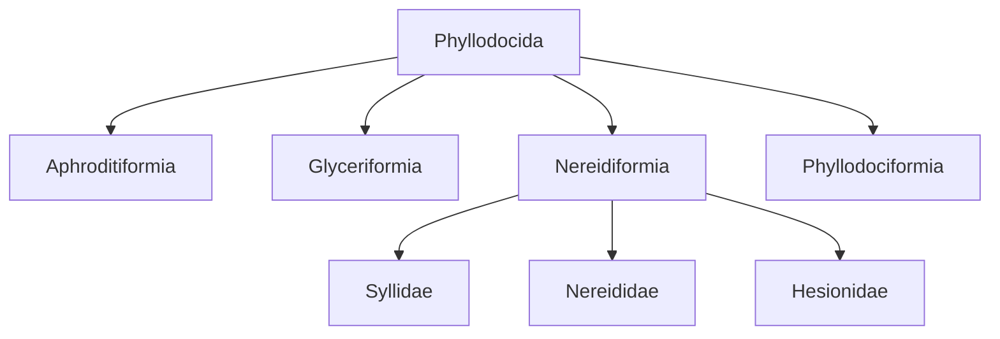

# MiAphro, a collection of 16S and 28S PCR primer candidates for polychaete eDNA metabarcoding

**Fei Xia**

[English](README.en.md) | 中文

## 项目概览

MiAphro整合Phyllodocida内8个相互嵌套的设计单元：目级、4个亚目及3个科。现行目录包含94对引物（188条寡核苷酸），另有8对不同的条件备选（16条寡核苷酸）。各设计单元保留自己的参考库、背景库和筛选条件；这些是分级设计的计算候选，并非一套覆盖全部多毛类的通用实验方案。

[现行序列](primers.fasta) · [完整目录](catalog.csv) · [参考库清单](panels.csv) · [条件备选](conditional/README.md) · [方法与复现](docs/METHODS.md)

## 设计单元

|目标类群|层级|16S参考物种|28S参考物种|结果入口|
|---|---|---:|---:|---|
|Aphroditiformia|亚目|94|68|[Aphroditiformia](panels/Aphroditiformia/README.md)|
|Phyllodocida|目|515|302|[Phyllodocida](panels/Phyllodocida/README.md)|
|Glyceriformia|亚目|20|12|[Glyceriformia](panels/Glyceriformia/README.md)|
|Nereidiformia|亚目|315|133|[Nereidiformia](panels/Nereidiformia/README.md)|
|Phyllodociformia|亚目|59|63|[Phyllodociformia](panels/Phyllodociformia/README.md)|
|Syllidae|科|180|28|[Syllidae](panels/Syllidae/README.md)|
|Nereididae|科|61|52|[Nereididae](panels/Nereididae/README.md)|
|Hesionidae|科|53|45|[Hesionidae](panels/Hesionidae/README.md)|



示意图仅列出本项目的设计单元，不是完整分类系统。上下级面板包含重叠物种，不能直接相加。

## 命名与方案

`MiAphro-{目标类群}-{基因}-{长度}[2][D]_{F|R}`。S/M/L表示短、中、长设计；D表示该对引物至少一条含简并，每条简并度≤8。数字2表示另一套条件候选，不表示两对引物混合。例：`MiAphro-Syllidae-16S-S_F`、`MiAphro-Syllidae-16S-SD_R`、`MiAphro-Syllidae-16S-S2D_R`。同一方案内普通/D的四个结合端点一致；不同方案、类群可能使用不同窗口和参考序列。

## 结果概览


图示为各自冻结参考库内的D方案覆盖率。不同设计单元的分母和背景组成不同，不能解释为共同面板上的直接性能比较。

- **Aphroditiformia**: 保留原鳞虫研究、碱基匹配图、WoRMS属级覆盖与预印本。
- **Phyllodocida**: 目级覆盖仍低，保留为广谱搜索结果。
- **Glyceriformia**: 参考未包含Lacydoniidae；16S覆盖与完全匹配之间存在明显差距。
- **Nereidiformia**: 亚目级覆盖仍低；另提供三个科的独立设计。
- **Phyllodociformia**: 当前参考仅代表Phyllodocidae。
- **Syllidae**: 优先关注16S。28S的S/M覆盖很低，L无通过候选。
- **Nereididae**: 16S覆盖较高；28S以S为主要候选，M/L覆盖仍有限。
- **Hesionidae**: 28S S覆盖40/45种；完整长度比较见本单元结果。

最新Nereididae 28S SD覆盖29/52种，完全匹配8种。条件备选Syllidae 16S S2D覆盖126/180种、完全匹配48种；在3675种背景中，严格WC/GT命中33/42，宽松模型命中1007/601。条件备选与现行FASTA分开保存。

## 数据、复现与证据

[逐物种结果](species.csv) · [来源与命名对应](provenance.csv) · [独立重扫检查](audit/catalog_rescan.json) · [文件校验值](SHA256SUMS)

```bash
python3 -m pip install -r requirements.txt
python3 scripts/build_catalog.py
python3 scripts/build_docs.py
python3 scripts/check_release.py
# Optional full independent re-scan / 可选：完整独立重扫
python3 scripts/recheck_catalog.py
```

冻结参考序列和比对位于`panels/`，精简后的源分析位于`analysis/`。大型中间命中矩阵与缓存可重建，不重复收录。入选结果已使用独立C++和Python实现重新扫描；本次整合未添加实验验证。

## Aphroditiformia原研究与预印本

[Study and bibliography](studies/Aphroditiformia/README.md) · [Preprint PDF](studies/Aphroditiformia/publications/MiAphro_preprint.pdf) · [Manuscript](studies/Aphroditiformia/publications/MiAphro_preprint.md)

保留的预印本仅报告Aphroditiformia。新增目级、亚目级和科级设计由当前目录及各单元页面报告，不将其归入原预印本结论。

## 引用与著作权

Xia, F. (2026). *MiAphro, a collection of 16S and 28S PCR primer candidates for polychaete eDNA metabarcoding*. [MiAphro](https://github.com/GUIBA-EX/MiAphro).

[Citation metadata](CITATION.cff) · [Copyright and permissions](COPYRIGHT.md)
