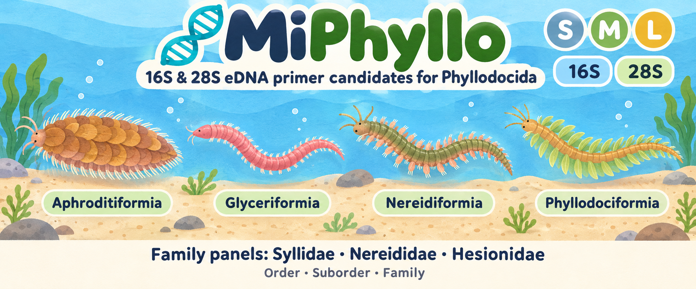
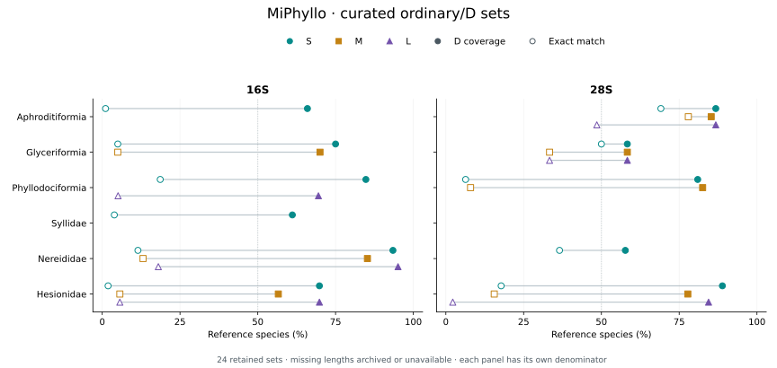
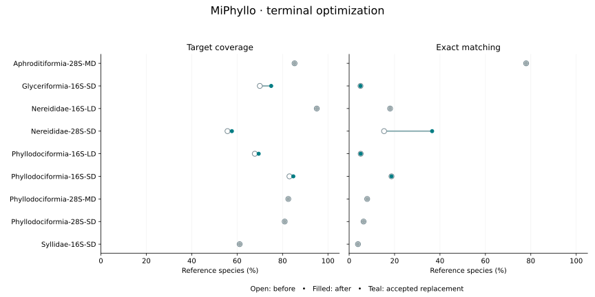

# MiPhyllo: taxon-stratified 16S and 28S PCR primer candidates for environmental DNA metabarcoding of Phyllodocida

**Fei Xia**

[English](README.en.md) | 中文

[Preprint PDF](publications/MiPhyllo_preprint.pdf) · [Manuscript](publications/MiPhyllo_preprint.md)

## 项目概览

精简目录保留**48对引物（96条寡核苷酸），组成24组同坐标普通/D方案，覆盖6个设计单元**：3个亚目和3个科。原始搜索涉及8个单元。各单元独立保存一物种一序列的参考库与背景库。Phyllodocida表示项目研究范围，现行目录不再保留目级引物。

[现行序列](primers.fasta) · [现行目录](catalog.csv) · [逐物种结果](species.csv) · [方法](docs/METHODS.md) · [归档与取舍](archive/README.md)

顶部简介图展示分类背景；Nereidiformia由三个科级面板代表，不表示保留了亚目通用引物。

## 保留方案

|目标类群|16S长度|28S长度|16S参考物种|28S参考物种|结果入口|
|---|---|---|---:|---:|---|
|Aphroditiformia|S|S/M/L|94|68|[Aphroditiformia](panels/Aphroditiformia/README.md)|
|Glyceriformia|S/M|S/M/L|20|12|[Glyceriformia](panels/Glyceriformia/README.md)|
|Phyllodociformia|S/L|S/M|59|63|[Phyllodociformia](panels/Phyllodociformia/README.md)|
|Syllidae|S|—|180|28|[Syllidae](panels/Syllidae/README.md)|
|Nereididae|S/M/L|S|61|52|[Nereididae](panels/Nereididae/README.md)|
|Hesionidae|S/M/L|S/M/L|53|45|[Hesionidae](panels/Hesionidae/README.md)|

参考物种数表示可用参考库规模，不表示该基因一定保留引物。每个保留长度均含普通与D两对。

## 筛选与命名

保留D覆盖率≥50%、至少有1种完全匹配且通过原完整背景筛选的普通/D组合。Phyllodocida、Nereidiformia大范围方案及放宽背景限制的条件备选归档。这是目录精简规则，不是实验有效性阈值。普通引物保留为同坐标对照，D达到标准不代表普通引物也达到50%覆盖率。

`MiPhyllo-{类群}-{基因}-{S|M|L}[D]_{F|R}`。普通引物仅含A/C/G/T；D表示至少一条含简并。每条简并度≤8，简并限于3′半段。普通/D四个结合端点相同；S/M/L是长度分档，不要求凑齐。

## 结果概览



实心点为D覆盖率，空心点为完全匹配率，灰线表示二者差距。缺失长度表示已移除或原本无候选。各自完整参考库作为分母，不作共同面板性能比较。

- **Aphroditiformia**: 16S仅保留S；28S保留S/M/L。16S SD覆盖62/94种，完全匹配仅1种。
- **Glyceriformia**: 16S保留S/M，28S保留S/M/L；16S两个D均仅1种完全匹配。参考未包含Lacydoniidae。
- **Phyllodociformia**: 16S保留S/L，28S保留S/M。参考仅代表Phyllodocidae。
- **Syllidae**: 仅保留16S S/SD；28S和其余长度归档。
- **Nereididae**: 16S保留S/M/L，28S仅保留S。16S LD覆盖最高，但背景命中高于SD。
- **Hesionidae**: 16S与28S均保留S/M/L。28S SD覆盖40/45种，完全匹配8种。

## 3′端联合优化

对9对D进行联合简并重分配。4对覆盖提高且完全匹配不降；包括Syllidae 16S SD在内的5对保留原序列。替换方案保持坐标、每条简并度≤8及原完整背景筛选条件。

[完整比较与方法](optimization/terminal_2026-11-05/README.md)

|D pair|Covered before → after|Exact before → after|Strict WC/GT before → after|Loose WC/GT before → after|Decision|
|---|---:|---:|---|---|---|
|Aphroditiformia-28S-MD|58 → 58 / 68|53 → 53 / 68|1/2 → 1/2|17/2 → 17/2|retain|
|Glyceriformia-16S-SD|14 → 15 / 20|1 → 1 / 20|14/33 → 13/33|113/104 → 107/105|replace|
|Nereididae-16S-LD|58 → 58 / 61|11 → 11 / 61|30/58 → 30/58|166/285 → 166/285|retain|
|Nereididae-28S-SD|29 → 30 / 52|8 → 19 / 52|0/0 → 0/0|0/0 → 0/0|replace|
|Phyllodociformia-16S-LD|40 → 41 / 59|3 → 3 / 59|0/1 → 0/0|76/29 → 80/31|replace|
|Phyllodociformia-16S-SD|49 → 50 / 59|11 → 11 / 59|0/8 → 0/12|81/11 → 82/15|replace|
|Phyllodociformia-28S-MD|52 → 52 / 63|5 → 5 / 63|21/26 → 21/26|95/42 → 95/42|retain|
|Phyllodociformia-28S-SD|51 → 51 / 63|4 → 4 / 63|7/23 → 7/23|53/53 → 53/53|retain|
|Syllidae-16S-SD|110 → 110 / 180|7 → 7 / 180|1/2 → 1/2|15/2 → 15/2|retain|



## 复现与证据

[Selection decisions](archive/selection_decisions.csv) · [Curation audit](audit/curation.json) · [Independent scan](audit/catalog_rescan.json) · [Provenance](provenance.csv) · [Checksums](SHA256SUMS)

目录仍为48对：44对保持原序列，4对D经联合简并重分配及目标/背景独立复核后替换。普通引物和所有结合端点保持不变。原始结果与旧版预印本保留在归档中，未新增实验验证。

```bash
python3 -m pip install -r requirements.txt
python3 scripts/build_catalog.py
python3 scripts/build_docs.py
python3 scripts/plot_catalog.py  # requires matplotlib
python3 publications/render_integrated.py  # requires pandoc and Chrome
python3 scripts/update_checksums.py
python3 scripts/check_release.py
```

## 原始研究

[Aphroditiformia study](studies/Aphroditiformia/README.md) · [Historical PDF](studies/Aphroditiformia/publications/MiAphro_preprint.pdf)

原研究保留完整搜索结果与图表；精简后的保留方案以本页现行目录为准。

## 引用与著作权

Xia, F. (2026). *MiPhyllo: taxon-stratified 16S and 28S PCR primer candidates for environmental DNA metabarcoding of Phyllodocida*. [MiPhyllo](https://github.com/GUIBA-EX/MiPhyllo).

[Citation metadata](CITATION.cff) · [Copyright and permissions](COPYRIGHT.md)
