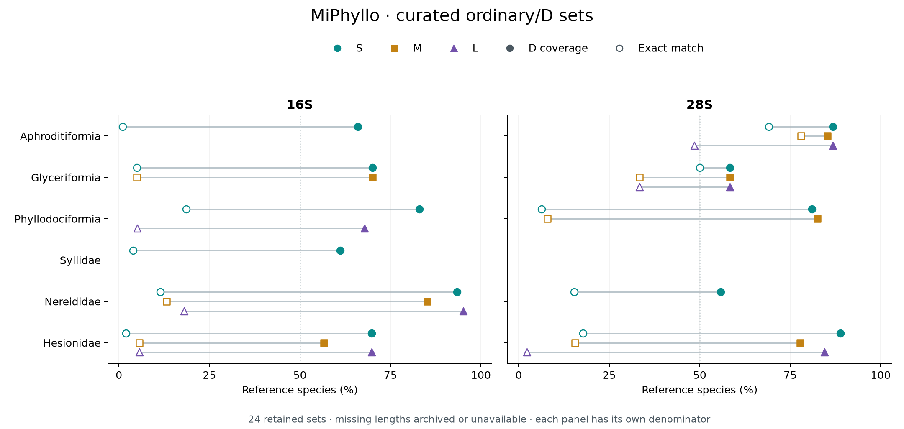

MiPhyllo: taxon-stratified 16S and 28S PCR primer candidates for
environmental DNA metabarcoding of Phyllodocida

# MiPhyllo: taxon-stratified 16S and 28S PCR primer candidates for environmental DNA metabarcoding of Phyllodocida

Fei Xia

Computational preprint · Curated edition · 5 November 2026

## Abstract

Broad taxonomic scope can conflict with reference coverage and
background specificity when designing environmental DNA primers for
marine annelids. We curated mitochondrial 16S and nuclear 28S candidates
from searches of eight nested Phyllodocida target units. Reference
panels retained one sequence per named species. Ordinary and degenerate
(D) primers shared binding endpoints, with degeneracy limited to eight
variants per oligo. The initial collection contained 94 standard pairs
and eight relaxed-background alternatives. We retained standard
ordinary/D sets when D coverage reached at least 50% and at least one
reference species matched exactly, while withdrawing order-wide
Phyllodocida and suborder-wide Nereidiformia designs. These operational
catalogue criteria retained 24 sets, comprising 48 primer pairs and 96
oligos, across six units. Nereididae 16S LD covered 58/61 references
with 11 exact matches; Hesionidae 28S SD covered 40/45 with eight exact
matches. Coverage and exact matching remained markedly different for
several retained designs. All retained sequences and scores are
unchanged subsets of the 102 originally independently re-scanned pairs.
The other 54 pairs, source results and previous preprint are archived.
The curated collection supports target-specific candidate selection; the
thresholds and matching results do not constitute experimental
validation.

## 1. Introduction

Phyllodocida comprises divergent polychaete lineages for which a single
short rRNA assay may not reconcile coverage and specificity. Scale-worm
phylogenetic reference data provide an established starting point \[1\],
while environmental DNA has been applied to marine metazoan surveys
\[2\]. MiFish illustrates the design principle of conserved
primer-binding regions surrounding variable sequence \[3\]. Here that
principle guides annelid candidate searches without transferring
fish-primer sequences or assuming equivalent performance.

The original searches considered the order, four suborders and three
families. The present revision separates useful candidate sets from
low-coverage exploratory outcomes. Phyllodocida remains the scope of
MiPhyllo, but its order-wide assay is no longer in the current
catalogue. Nereidiformia is represented by three family-level panels.
Retained and removed designs are traceable to the same frozen source
data.

## 2. Materials and methods

### 2.1 References and design

Each gene panel retained one reference per named species, prioritizing
sequence completeness during source curation. The original units were
Phyllodocida; Aphroditiformia, Glyceriformia, Nereidiformia and
Phyllodociformia; and Syllidae, Nereididae and Hesionidae. Nested panels
are not independent samples. Direction-adjusted MAFFT alignments \[4\]
guided homologous windows; accession metadata, alignments and frozen
backgrounds are distributed with each unit.

Selected spans use S 100-200 bp, M 201-300 bp and L 301-480 bp; original
narrower search ranges remain in source scripts. Expanded searches used
18-30 nt oligos and 1 nt start increments, with frequent haplotypes,
consensus seeds, staged coverage/exact-match ranking and local
refinement. Ordinary/D pairs share all four binding endpoints.
Degeneracy is ≤8 per oligo and limited to its 3′ half; the ordinary
sequence need not be contained in its D expansion. Thermodynamic filters
used 50 nM per variant and 200 nM per direction, minimum predicted Tm
≥45°C, F/R midpoint difference ≤5°C and structure Tm \<55°C.

### 2.2 Matching and background selection

Target coverage required ≤2 mismatches per end, compatible terminal
three bases, total product length 100-500 bp and internal length ≥50 bp.
Exact matching required zero mismatches at both ends, with IUPAC
compatibility treated as a match. All reference species, including
fragments lacking the complete window, remain in the denominator.
Background scans permit internal gaps of 0-1000 bp. Strict WC/GT allows
≤2 mismatches and requires terminal compatibility; loose WC allows ≤3
mismatches and loose GT ≤2 without terminal constraints. GT additionally
permits primer-oriented G:A and T:C compatibility as a sensitivity
model.

The original Aphroditiformia study used a six-group polychaete
background and limits of ten strict and fifty loose hits per model.
Later suborder/family searches used expanded marine and non-target
Phyllodocida references, strict WC≤1%, GT≤3%, loose WC≤5%, GT≤10%, and
each strict close-relative count≤max(2, floor(3% × close-relative N)).
Marine screening used inherited genus-level WoRMS assignments.
Background composition differs between panels.

### 2.3 Catalogue curation and verification

We retained standard ordinary/D sets with D reference coverage ≥50% and
at least one exact reference match, preserving the original full
background profile. Phyllodocida and Nereidiformia broad-target designs
were withdrawn. All alternatives selected without a loose-model veto
were archived. The thresholds are operational editorial criteria, not
empirically established efficacy thresholds. Ordinary counterparts
remain coordinate-matched comparators and need not themselves reach 50%
coverage. Lengths are not removed merely because another length has
greater coverage.

The retained 48 pairs are sequence- and score-identical subsets of the
102 originally scanned pairs, for which C++ and independent Python
implementations agreed record by record. This revision checks selection
membership, unchanged sequences and statistics, FASTA exports, endpoint
identity, degeneracy, bilingual tables and archive completeness. It
introduces no fresh sequence design, experimental validation,
common-panel evaluation or independent holdout test.

## 3. Results

### 3.1 Retained units and length classes

| Target unit      | 16S N | 16S lengths | 28S N | 28S lengths |
|------------------|-------|-------------|-------|-------------|
| Aphroditiformia  | 94    | S           | 68    | S/M/L       |
| Glyceriformia    | 20    | S/M         | 12    | S/M/L       |
| Phyllodociformia | 59    | S/L         | 63    | S/M         |
| Syllidae         | 180   | S           | 28    | None        |
| Nereididae       | 61    | S/M/L       | 52    | S           |
| Hesionidae       | 53    | S/M/L       | 45    | S/M/L       |

**Table 1.** Available reference species and retained lengths. Each
retained length includes an ordinary and a D pair. Syllidae retains its
28S reference library but no current 28S primer. Counts describe each
frozen panel and must not be summed across nested units.

**Figure 1.** D coverage (filled) and exact matching (open) in the
retained catalogue. Connectors show their difference. Missing lengths
were archived or had no original candidate. Percentages use each panel's
own denominator and are not common-panel performance comparisons.

Six target units retain 24 ordinary/D sets (48 pairs, 96 oligos).
Neither the order-wide Phyllodocida nor suborder-wide Nereidiformia
candidates remain. Phyllodociformia references represent Phyllodocidae
only. Glyceriformia references do not include Lacydoniidae. Appendix A
lists every retained sequence and its matching outcomes.

## 3.2 Selection tradeoffs and archived outcomes

The 94 standard and eight conditional original pairs partition into 48
retained and 54 archived pairs. Phyllodocida designs covered at most
71/515 16S and 53/302 28S references; Nereidiformia reached at most
62/315 and 45/133. These outcomes remain available as exploratory
results rather than recommended broad-target assays.

Further removals include Aphroditiformia 16S M/L, Glyceriformia 16S L,
Syllidae 16S M/L and all its 28S candidates, and Nereididae 28S M/L.
Phyllodociformia 16S M and 28S L were archived because their D
candidates had no exact reference matches despite coverage above 50%.
All eight conditional pairs were archived: relaxed Syllidae alternatives
had substantial loose-background matching, whereas the Nereididae 28S
alternative also remained below 50% coverage. Per-set decisions and
original scores are distributed in the archive.

Retained designs still show tradeoffs. Aphroditiformia 16S SD covers
62/94 but matches only one species exactly; Glyceriformia 16S SD/MD each
cover 14/20 with one exact match. Syllidae 16S SD covers 110/180 with
seven exact matches. Nereididae 16S LD covers 58/61 with 11 exact
matches but has strict WC/GT background counts of 30/58, compared with
0/12 for SD (57/61 covered). Nereididae 28S SD covers 29/52 with eight
exact matches and zero hits in all four background models. Hesionidae
28S SD covers 40/45 with eight exact matches.

## 4. Discussion

Catalogue inclusion should reflect a plausible target scope and
transparent tradeoffs, not the mere existence of a search result. The
present pruning removes clearly weak broad-target outcomes and avoids
filling every gene-by-length cell. It preserves different retained
lengths because coverage alone does not establish their equivalence for
fragmented DNA or the taxonomic resolution of the internal amplicon.

The 50% coverage and nonzero-exact criteria provide a reproducible
editorial boundary. They are not optimized or validated biological
cutoffs, and several retained candidates have very low exact-match
rates. Thus inclusion does not imply uniform performance across a
lineage. Reference availability, incomplete fragments and uneven family
representation affect all estimates. Ordinary primers are comparators
rather than independent confirmations of D performance. Concentration
effects of degeneracy and sensitivity to mismatches remain unmeasured
experimentally.

Stratification narrows the target and changes the non-target background;
it does not demonstrate that family assays outperform suborder assays on
a common panel. Three Nereidiformia family panels do not cover every
family of that suborder. Archived sequences, scores and the former
preprint preserve the search history without presenting all outcomes as
current recommendations.

## 5. Conclusion and data availability

MiPhyllo retains 48 computational primer pairs across six target units
and archives 54 other pairs. Sequences, references, matching outcomes,
selection decisions, source algorithms and independent verification
records are available at
[github.com/GUIBA-EX/MiPhyllo](https://github.com/GUIBA-EX/MiPhyllo).
Current identifiers follow
MiPhyllo-{target}-{gene}-{S\|M\|L}\[D\]\_{F\|R}. Copyright © 2026 Fei
Xia; repository copyright and third-party data terms apply.

## References

\[1\] Norlinder E et al. (2012). Phylogeny of scale-worms
(Aphroditiformia, Annelida), assessed from 18SrRNA, 28SrRNA, 16SrRNA,
mitochondrial cytochrome c oxidase subunit I (COI), and morphology.
*Molecular Phylogenetics and Evolution*. PMID: 22789762.

\[2\] Environmental DNA metabarcoding for monitoring metazoan
biodiversity in Antarctic nearshore ecosystems (2021). *PeerJ* 9:e12458.
doi:10.7717/peerj.12458.

\[3\] Miya M et al. (2015). MiFish, a set of universal PCR primers for
metabarcoding environmental DNA from fishes: detection of more than 230
subtropical marine species. *Royal Society Open Science* 2:150088.
doi:10.1098/rsos.150088.

\[4\] Katoh K, Standley DM (2013). MAFFT multiple sequence alignment
software version 7: improvements in performance and usability.
*Molecular Biology and Evolution* 30:772–780. doi:10.1093/molbev/mst010.

## Appendix A1. Aphroditiformia

Canonical prefix: MiPhyllo-Aphroditiformia-. Sequences are 5′→3′.
Covered and exact counts use the full target reference denominator.
Strict and loose background values are WC/GT. Ordinary primers are
same-coordinate comparators.

| Gene/pair | bp  | Covered | Exact | Strict bg | Loose bg |
|-----------|-----|---------|-------|-----------|----------|
| 16S-S     | 138 | 58/94   | 1/94  | 0/0       | 23/0     |
| 16S-SD    | 138 | 62/94   | 1/94  | 0/0       | 25/0     |
| 28S-S     | 148 | 54/68   | 29/68 | 0/0       | 16/2     |
| 28S-SD    | 148 | 59/68   | 47/68 | 2/2       | 19/2     |
| 28S-M     | 250 | 56/68   | 50/68 | 0/0       | 16/0     |
| 28S-MD    | 250 | 58/68   | 53/68 | 1/2       | 17/2     |
| 28S-L     | 368 | 58/68   | 22/68 | 0/0       | 15/0     |
| 28S-LD    | 368 | 59/68   | 33/68 | 0/1       | 18/1     |

### Primer sequences

| Gene/pair | Forward                | Reverse                |
|-----------|------------------------|------------------------|
| 16S-S     | ATAAACTACCTTAGGGATAACA | GAGATTTAACAGTTGAACAAAC |
| 16S-SD    | ATAAACTACCTYRGGGATAACA | GAGATTTAACAGTTGAACRAAC |
| 28S-S     | CTCAGAGGCAAACTGATGGGAC | GCTCTCCTCGTGGAAAGGGC   |
| 28S-SD    | CTCAGAGGCAAACYGATGGGAC | GCTCTCCTCGYRGAAAGKGC   |
| 28S-M     | AATCCCCTGTCGCTGCGGCA   | TCCCTCACGGTACTTGTCCGCT |
| 28S-MD    | AATCCCCTGTCGYTGCGGCA   | TCCCTCACGGTACTTGTCCKCT |
| 28S-L     | CTCAGAGGCAAACTGATGGGAC | CGGAACACACTGTAAACAGTCC |
| 28S-LD    | CTCAGAGGCAAACYGATGGGAC | CGGAACACACTGTRAACAGTCC |

Binding coordinates, accessions and per-species matches:
panels/Aphroditiformia/results.csv and species.csv. Ordinary/D
counterparts share all four endpoints. No archived candidate is included
in these tables.

## Appendix A2. Glyceriformia

Canonical prefix: MiPhyllo-Glyceriformia-. Sequences are 5′→3′. Covered
and exact counts use the full target reference denominator. Strict and
loose background values are WC/GT. Ordinary primers are same-coordinate
comparators.

| Gene/pair | bp  | Covered | Exact | Strict bg | Loose bg |
|-----------|-----|---------|-------|-----------|----------|
| 16S-S     | 110 | 8/20    | 0/20  | 2/3       | 60/27    |
| 16S-SD    | 110 | 14/20   | 1/20  | 14/33     | 113/104  |
| 16S-M     | 252 | 7/20    | 1/20  | 1/1       | 40/17    |
| 16S-MD    | 252 | 14/20   | 1/20  | 10/13     | 81/35    |
| 28S-S     | 106 | 7/12    | 4/12  | 0/2       | 1/28     |
| 28S-SD    | 106 | 7/12    | 6/12  | 0/3       | 7/31     |
| 28S-M     | 236 | 5/12    | 4/12  | 0/4       | 90/35    |
| 28S-MD    | 236 | 7/12    | 4/12  | 0/4       | 93/35    |
| 28S-L     | 324 | 5/12    | 4/12  | 0/1       | 49/26    |
| 28S-LD    | 324 | 7/12    | 4/12  | 0/1       | 49/26    |

### Primer sequences

| Gene/pair | Forward                | Reverse                |
|-----------|------------------------|------------------------|
| 16S-S     | TAAATTTTGTTGGGGCGACA   | ATCCCTAAGGTAGCTATTTCCT |
| 16S-SD    | TAAATTTTGTTGGGGCGACA   | ATCCCTATGGTAGCTRWTTYCT |
| 16S-M     | CACGAAAATAAAGCTGTCTC   | CCCTAAGGTAGCTATTTCCT   |
| 16S-MD    | CACGAAAATAAWDCTGTCTC   | CCCTAAGGTAGCTRTTTYCT   |
| 28S-S     | ACGGCGAGTGAAGCGGGAAGAG | CTCGGACGCCAGAACGCTGC   |
| 28S-SD    | ACGGCGAGTGAAGCGGGAWGAG | CTCGGACGCCASAMCRCTGC   |
| 28S-M     | GCGGACAAGTACCGTGAG     | GAAAACCGGTCGTGGCTA     |
| 28S-MD    | GCGGACAAGTACCGTGAG     | GAAAACCGGTCGTGGCYA     |
| 28S-L     | CGTCCTTGGAGTCGGGTTGT   | CGGAAAACCGGTCGTGGCTA   |
| 28S-LD    | CGTCCTTGGAGTCGGGTTGT   | CGGAAAACCGGTCGTGGCYA   |

Binding coordinates, accessions and per-species matches:
panels/Glyceriformia/results.csv and species.csv. Ordinary/D
counterparts share all four endpoints. No archived candidate is included
in these tables.

## Appendix A3. Phyllodociformia

Canonical prefix: MiPhyllo-Phyllodociformia-. Sequences are 5′→3′.
Covered and exact counts use the full target reference denominator.
Strict and loose background values are WC/GT. Ordinary primers are
same-coordinate comparators.

| Gene/pair | bp  | Covered | Exact | Strict bg | Loose bg |
|-----------|-----|---------|-------|-----------|----------|
| 16S-S     | 118 | 31/59   | 2/59  | 0/0       | 10/3     |
| 16S-SD    | 118 | 49/59   | 11/59 | 0/8       | 81/11    |
| 16S-L     | 308 | 27/59   | 2/59  | 0/0       | 9/4      |
| 16S-LD    | 308 | 40/59   | 3/59  | 0/1       | 76/29    |
| 28S-S     | 198 | 49/63   | 4/63  | 5/18      | 35/30    |
| 28S-SD    | 198 | 51/63   | 4/63  | 7/23      | 53/53    |
| 28S-M     | 298 | 12/63   | 6/63  | 0/0       | 44/12    |
| 28S-MD    | 298 | 52/63   | 5/63  | 21/26     | 95/42    |

### Primer sequences

| Gene/pair | Forward                  | Reverse                |
|-----------|--------------------------|------------------------|
| 16S-S     | ATAGTTACCATAGGGATAACAGGC | ACCAACCCTTATAGACTGCTAC |
| 16S-SD    | ATAGTTACCATAGGGATAACAGGC | ACCAACCCTTATARRCTGCTRC |
| 16S-L     | ACCTAAATTTTAATGAAAGACA   | TTGAACAAACCAACCCTT     |
| 16S-LD    | ACCTAAATTTTAATRWARGACA   | TTGAACAAACYWACCCTY     |
| 28S-S     | GAAAGCCACGACCGGTTC       | CACTGTGAACAGTCCTCGCCAG |
| 28S-SD    | GAAAGCCACGACCGGTTC       | CACTGTGAACAGTCCTCVCCWG |
| 28S-M     | GTCCTTGGAGTCGGGTTGTTTG   | AAAGTGCGCCCACCGACCAC   |
| 28S-MD    | GTCCTTGGAGTCGGGTTGTTTG   | AAAGTGCACCCACCGACNRC   |

Binding coordinates, accessions and per-species matches:
panels/Phyllodociformia/results.csv and species.csv. Ordinary/D
counterparts share all four endpoints. No archived candidate is included
in these tables.

## Appendix A4. Syllidae

Canonical prefix: MiPhyllo-Syllidae-. Sequences are 5′→3′. Covered and
exact counts use the full target reference denominator. Strict and loose
background values are WC/GT. Ordinary primers are same-coordinate
comparators.

| Gene/pair | bp  | Covered | Exact | Strict bg | Loose bg |
|-----------|-----|---------|-------|-----------|----------|
| 16S-S     | 142 | 55/180  | 2/180 | 0/2       | 4/2      |
| 16S-SD    | 142 | 110/180 | 7/180 | 1/2       | 15/2     |

### Primer sequences

| Gene/pair | Forward            | Reverse              |
|-----------|--------------------|----------------------|
| 16S-S     | AAAGACAGAAAGACCCTA | CCCTACAGTAGCTTACTTAT |
| 16S-SD    | AAAGACAGAAAGWCCCTH | CCCTACAGTARCTTACTTRW |

Binding coordinates, accessions and per-species matches:
panels/Syllidae/results.csv and species.csv. Ordinary/D counterparts
share all four endpoints. No archived candidate is included in these
tables.

## Appendix A5. Nereididae

Canonical prefix: MiPhyllo-Nereididae-. Sequences are 5′→3′. Covered and
exact counts use the full target reference denominator. Strict and loose
background values are WC/GT. Ordinary primers are same-coordinate
comparators.

| Gene/pair | bp  | Covered | Exact | Strict bg | Loose bg |
|-----------|-----|---------|-------|-----------|----------|
| 16S-S     | 194 | 30/61   | 7/61  | 0/0       | 16/6     |
| 16S-SD    | 194 | 57/61   | 7/61  | 0/12      | 51/25    |
| 16S-M     | 212 | 52/61   | 8/61  | 5/9       | 48/12    |
| 16S-MD    | 212 | 52/61   | 8/61  | 8/14      | 66/19    |
| 16S-L     | 412 | 38/61   | 6/61  | 0/40      | 66/106   |
| 16S-LD    | 412 | 58/61   | 11/61 | 30/58     | 166/285  |
| 28S-S     | 150 | 19/52   | 1/52  | 0/0       | 0/0      |
| 28S-SD    | 150 | 29/52   | 8/52  | 0/0       | 0/0      |

### Primer sequences

| Gene/pair | Forward              | Reverse                |
|-----------|----------------------|------------------------|
| 16S-S     | AATTTGGTTGGGACAACC   | CTGTCAATGTGGTCTCTCTAGT |
| 16S-SD    | AATTTGGTTGGGACRAYY   | CTGTCAATGTGRTCTCTCTARY |
| 16S-M     | AAGGACAAGAAGACCCTA   | AATAGTTACACTAAGCCAAC   |
| 16S-MD    | AAGGACAAGAAGACCCTA   | AATAGTTACAYWRAGCCAAC   |
| 16S-L     | TTAATTGAAGGCTAGTATGA | CAATGTGATCTCTCTAGT     |
| 16S-LD    | TTAATTGAAGGYYRGTATGA | CAATGTGATCTCTCTARY     |
| 28S-S     | GACGCGTGCACTTTCCGG   | CAGAGGGCCTGCGACTCG     |
| 28S-SD    | GACGCGTGCAMTTTCCRG   | CAGAGGGCCTGCGACYHG     |

Binding coordinates, accessions and per-species matches:
panels/Nereididae/results.csv and species.csv. Ordinary/D counterparts
share all four endpoints. No archived candidate is included in these
tables.

## Appendix A6. Hesionidae

Canonical prefix: MiPhyllo-Hesionidae-. Sequences are 5′→3′. Covered and
exact counts use the full target reference denominator. Strict and loose
background values are WC/GT. Ordinary primers are same-coordinate
comparators.

| Gene/pair | bp  | Covered | Exact | Strict bg | Loose bg |
|-----------|-----|---------|-------|-----------|----------|
| 16S-S     | 188 | 28/53   | 2/53  | 1/7       | 1/7      |
| 16S-SD    | 188 | 37/53   | 1/53  | 1/43      | 32/44    |
| 16S-M     | 258 | 24/53   | 1/53  | 22/43     | 48/47    |
| 16S-MD    | 258 | 30/53   | 3/53  | 22/44     | 68/48    |
| 16S-L     | 362 | 28/53   | 2/53  | 2/8       | 7/27     |
| 16S-LD    | 362 | 37/53   | 3/53  | 2/60      | 50/69    |
| 28S-S     | 196 | 31/45   | 3/45  | 5/14      | 22/17    |
| 28S-SD    | 196 | 40/45   | 8/45  | 10/44     | 78/70    |
| 28S-M     | 252 | 28/45   | 6/45  | 1/4       | 17/7     |
| 28S-MD    | 252 | 35/45   | 7/45  | 2/8       | 47/11    |
| 28S-L     | 416 | 38/45   | 1/45  | 22/29     | 77/33    |
| 28S-LD    | 416 | 38/45   | 1/45  | 22/29     | 77/33    |

### Primer sequences

| Gene/pair | Forward                      | Reverse                  |
|-----------|------------------------------|--------------------------|
| 16S-S     | TGAACTAAGGTTTTAACGGC         | AAACTCTATAGGGTCTTCTTGTCT |
| 16S-SD    | TGAATTACGGYTTHAACGGC         | AAACTCAATAGGGTCTTCTTGTCY |
| 16S-M     | ACGGTTTTAACGGCCGCGGT         | TCCCCAGTCGCCCCAACTAA     |
| 16S-MD    | ACGGTTTTAACGGCYGCGGT         | TCCCCAGTCGCCCCAACYAA     |
| 16S-L     | TGAACTAAGGTTTTAACG           | ATTAGCCTGTTATCCCTA       |
| 16S-LD    | TGAATTACGGYTTHAACG           | ATTAGCCTGTTAYCCCTR       |
| 28S-S     | CACTTTCCGCGGGGAGAG           | TGTGAACAGTCCTCCCCAGT     |
| 28S-SD    | CACTTTCCGYSGRGAGAG           | TGTGAACAGTCCTYCCMRGT     |
| 28S-M     | GACGAGCGCACTTTCCGC           | GAAGCACTGTGAACAGTCCT     |
| 28S-MD    | GACGAGCGCACTTTCCRB           | GAAGCACTGTRRRCAGTCCT     |
| 28S-L     | GAGTCGGGTTGTTTGAGAATGCAGCCCA | CGAGCCATAGGACGGGCACGGC   |
| 28S-LD    | GAGTCGGGTTGTTTGRGAATGCAGCCCA | CGAGCCATAGGACGGGCACGGC   |

Binding coordinates, accessions and per-species matches:
panels/Hesionidae/results.csv and species.csv. Ordinary/D counterparts
share all four endpoints. No archived candidate is included in these
tables.

